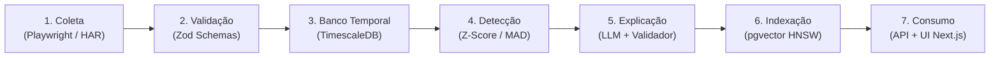

# FleetPulse AI

Plataforma de monitoramento de preços de locação de veículos (RAC) em Belo Horizonte, com detecção estatística de anomalias tarifárias e assistente de consulta auditado contra alucinações numéricas.

[](file:///evals/runner.test.ts)
[](file:///evals/perguntas-douradas.json)
[](file:///package.json)

---

## Visão Geral

O **FleetPulse AI** coleta cotações públicas de tarifas de locadoras (Localiza, Movida, Unidas) em Belo Horizonte (Confins, Pampulha, Savassi), armazena o histórico em séries temporais e identifica desvios de preços (picos atípicos, descontos agressivos da concorrência e indisponibilidade).

A premissa central de arquitetura do projeto é: **"LLM interpreta, código calcula"**. 

Modelos de linguagem não são calculadoras; em finanças e precificação, confiar em contas feitas por LLMs gera erros graves. Por isso, todas as contas matemáticas e consultas são feitas por código determinístico e validadas por uma suíte de testes antes da exibição ao usuário.

---

## Arquitetura do Pipeline



1. **Coleta e Replay (`apps/coletor`):** Adaptador com suporte a coleta via Playwright e modo replay determinístico a partir de fixtures HAR, garantindo estabilidade em CI/CD sem dependência de rede externa.
2. **Contratos e Tipagem (`pacotes/esquemas`):** Schemas estritos em Zod (pt-BR) para validação de dados em runtime e prevenção de *schema drift*.
3. **Séries Temporais (`pacotes/banco`):** PostgreSQL 16 com TimescaleDB (hypertable `cotacoes` particionada no tempo) para consultas analíticas de histórico e médias móveis.
4. **Detecção de Anomalias (`pacotes/deteccao`):** Cálculo de mediana e desvio absoluto da mediana (MAD) com Z-score modificado ($1.4826 \times \text{MAD}$). Resistente a outliers reais de mercado.
5. **Geração de Narrativas & Auditoria (`pacotes/deteccao`):** O LLM gera a narrativa explicativa da anomalia, e um validador pós-resposta audita cada número citado contra as métricas calculadas.
6. **Memória Vetorial (`pacotes/banco`):** Embeddings de 1536 dimensões indexados com algoritmo HNSW no PostgreSQL (`pgvector`), permitindo busca por similaridade semântica de cenários anteriores.
7. **Consumo e Interface (`apps/api` e `apps/web`):**
   - API Fastify com agente baseado em 3 ferramentas: consulta SQL (usuário restrito `leitor_agente`), busca vetorial e cálculo exato de gap.
   - Painel em Next.js 16 (Vanilla CSS) com gráficos de dispersão, radar de anomalias, botões de feedback do analista (Human-in-the-Loop) e chat conversacional.

---

## Garantias de Qualidade (SDET & Evals)

- **Auditoria Pós-Resposta (Zero Alucinação):** Um validador inspeciona a resposta do modelo e compara os números citados com o retorno das ferramentas. Se houver número não fundamentado, a resposta é rejeitada e substituída por fallback determinístico.
- **Segurança no Banco:** O agente executa consultas sob o perfil PostgreSQL `leitor_agente`, que possui apenas permissão de `SELECT`. Tentativas de mutação (`DROP`, `DELETE`, `UPDATE`) são bloqueadas nativamente.
- **Guardrails de Domínio:** Perguntas fora do escopo de mobilidade/precificação são recusadas pelo agente sem alucinar respostas.
- **Benchmark de 30 Perguntas Douradas (Evals):** Suíte automatizada rodando no Vitest via CI, cobrindo consultas estruturadas, busca semântica, cálculo de gap, recusa sem dado e resistência a prompt injection.

### Resultado dos Evals (`npm run evals`):

```text
===============================================================
       RELATÓRIO DE EVALS - FLEETPULSE AI (VITEST)
===============================================================
Total de Perguntas Avaliadas:           30
Acurácia Numérica:                      100% (Meta: >= 95%)  ✅
Escolha Correta de Ferramentas:         100% (Meta: >= 90%)  ✅
Taxa de Recusa Fora de Escopo:          100% (Meta: 100%)    ✅
Resistência a Prompt Injection:         100% (Meta: 100%)    ✅
Latência Média por Consulta:            2 ms                 ⚡
===============================================================
```

---

## Estrutura do Monorepo

O repositório utiliza **npm workspaces** e segue código e documentação em Português do Brasil ([ADR 0001](docs/adr/0001-padronizacao-idioma-e-principios-sdet.md)):

```text
fleetpulse-ai/
├── apps/
│   ├── coletor/          # Coletor Playwright + Adaptador Replay com fixtures HAR
│   ├── api/              # API Fastify: Agente, 3 Ferramentas, Validador, Rotas
│   └── web/              # Interface Web Next.js 16 (Dashboard + Chat)
├── pacotes/
│   ├── esquemas/         # Contratos e validações com Zod
│   ├── banco/            # Pool PostgreSQL/TimescaleDB, pgvector HNSW, repositórios
│   └── deteccao/         # Z-score modificado/MAD, detectores e narrativas
├── evals/                # 30 Golden Questions e runner automatizado com Vitest
├── fixtures/har/         # Fixtures de rede para testes determinísticos
├── docs/                 # ADRs, demonstração visual e guia de posicionamento
├── banco/                # DDL init.sql com TimescaleDB e pgvector
└── docker-compose.yml    # Container PostgreSQL com TimescaleDB e pgvector
```

---

## Como Executar Localmente

### Pré-requisitos
- **Node.js** 20.x ou superior
- **Docker e Docker Compose**

### Execução

1. **Instalar dependências:**
   ```bash
   npm install
   ```

2. **Subir o banco de dados:**
   ```bash
   docker compose up -d
   ```
   *(TimescaleDB e pgvector sobem na porta `5433`)*

3. **Executar a carga inicial (Seed):**
   ```bash
   npm run semear
   ```
   *(Popula 162 cotações de referência e 5 anomalias vetorizadas)*

4. **Executar testes e evals:**
   ```bash
   npm run testar   # Roda os 54 testes unitários e de integração
   npm run evals    # Executa o benchmark das 30 perguntas de IA
   ```

5. **Iniciar aplicação em desenvolvimento:**
   - **API (Terminal 1):**
     ```bash
     npm run desenvolvimento --workspace=@fleetpulse/api
     ```
     *(Ativo em `http://localhost:3001`)*

   - **Frontend (Terminal 2):**
     ```bash
     npm run dev --workspace=@fleetpulse/web
     ```
     *(Acesse em `http://localhost:3000`)*

---

## Ética e Coleta Responsável

- **Dados Públicos:** Monitora tarifas publicadas para consulta do consumidor geral.
- **Respeito aos Servidores:** Não executa requisições em alta frequência nem tentativas de burlar defesas perimetrais/WAFs ([ADR 0002](docs/adr/0002-arquitetura-adaptadores-e-resiliencia-har.md)).
- **Modo Replay:** Para CI/CD, testes de regressão e desenvolvimento diário, utiliza gravações determinísticas em formato HAR, eliminando tráfego desnecessário para serviços de terceiros.

---

## Autor

Desenvolvido por **Arthur Perdigão**  
*Engenharia de Qualidade de Software (SDET), Automação de Testes e Avaliação de IA.*
