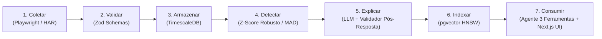

# 🚗 FleetPulse AI

> **Observabilidade de Preços de Mercado e Inteligência de Frotas com IA & QA Aplicado de Ponta a Ponta**  
> *Monorepo em TypeScript · PostgreSQL + TimescaleDB + pgvector · Fastify · Next.js · Evals Automatizados*

[-success?style=for-the-badge&logo=vitest)](file:///evals/runner.test.ts)
[](file:///evals/perguntas-douradas.json)
[](file:///apps/api/src/agente/agente-observabilidade.ts)
[](file:///package.json)

---

## 🎯 1. O Problema de Negócio

No setor de locação de veículos (RAC), a volatilidade de preços é extrema. Companhias como **Localiza**, **Movida** e **Unidas** ajustam tarifas diariamente por praça (aeroportos, centros urbanos) e categoria (econômicos, SUVs, sedãs) com base em sazonalidade, eventos e taxas de ocupação.

Para frotistas, analistas de precificação (pricing) e gestores de receita (revenue management), identificar movimentos agressivos da concorrência através de checagens manuais ou planilhas estáticas gera:
1. **Perda de receita** por reação tardia a reduções bruscas de tarifas dos concorrentes.
2. **Falta de contexto histórico**, dificultando saber se uma variação tarifária já ocorreu em feriados anteriores.
3. **Risco crítico de alucinação numérica** em ferramentas convencionais de IA generativa, que inventam valores financeiros ao analisar tabelas.

O **FleetPulse AI** resolve esse gargalo ao combinar **engenharia de dados para séries temporais**, **estatística não-paramétrica imune a outliers**, **busca vetorial semântica** e **garantia de zero alucinação numérica** através de auditoria pós-resposta com assinatura técnica de SDET (Software Development Engineer in Test).

---

## 🏗️ 2. Arquitetura do Pipeline em 7 Etapas

O sistema opera através de um pipeline desacoplado e resiliente:



1. **Coleta Resiliente (`apps/coletor`):** Adaptador dual que alterna entre coleta via Playwright e modo determinístico via fixtures HAR (respeito a WAFs e reprodutibilidade total em CI/CD).
2. **Validação de Contratos (`pacotes/esquemas`):** Schemas Zod com tipagem estrita em português brasileiro (`pt-BR`) prevenindo *schema drift*.
3. **Persistência Otimizada (`pacotes/banco`):** PostgreSQL 16 com TimescaleDB (hypertable `cotacoes` particionada no tempo) garantindo consultas analíticas ultrarrápidas.
4. **Detecção Estatística de Anomalias (`pacotes/deteccao`):** Cálculo de mediana e desvio absoluto da mediana (MAD) com Z-score modificado ($1.4826 \times \text{MAD}$), resistente a outliers reais de mercado.
5. **Geração de Narrativas & Auditoria Anti-Alucinação (`pacotes/deteccao`):** *"LLM interpreta, código calcula"*. Narrativas executivas geradas por LLM passam por um validador pós-resposta que audita cada dígito citado contra as métricas oficiais calculadas.
6. **Memória Semântica Vetorial (`pacotes/banco`):** Embeddings de 1536 dimensões indexados com algoritmo **HNSW** (`vector_cosine_ops`), permitindo recuperar anomalias passadas por similaridade de cosseno.
7. **Consumo Agêntico & Human-in-the-Loop (`apps/api` e `apps/web`):**
   - Agente de Observabilidade com 3 ferramentas especializadas em TypeScript: Consulta SQL somente-leitura, busca semântica vetorial e cálculo determinístico de gap tarifário.
   - Dashboard analítico e chat conversacional com interface em Next.js 16 (Vanilla CSS moderno, sem dependência de Tailwind).
   - Botões de **Human-in-the-Loop (HITL)** para analistas confirmarem ou corrigirem insights de anomalias detectadas.

---

## 🛡️ 3. Diferenciais de QA & SDET Aplicado à IA

Este projeto foi construído sob padrões rigorosos de engenharia de qualidade de software:

| Princípio de Qualidade | Implementação no FleetPulse AI | Benefício no Mundo Real |
|---|---|---|
| **Zero Alucinação Numérica** | Validador Pós-Resposta (`ValidadorRespostaChat` e `ValidadorNumerico`) audita cada número da resposta contra as saídas das ferramentas. | Decisões de precificação baseadas em dados 100% auditados. |
| **Defesa em Profundidade de Banco** | O agente executa SQL usando o perfil restrito `leitor_agente` (somente `SELECT`), com validação estática de regex e bloqueio nativo no PostgreSQL. | Imunidade completa contra `DROP TABLE`, `UPDATE` ou injeções DDL/DML. |
| **Guardrails de Escopo** | Filtros léxicos e semânticos barram perguntas fora do escopo de mobilidade (ex: cotações em Paris, cotações de commodities ou saldo bancário). | O agente não inventa respostas e recusa perguntas fora do seu domínio. |
| **Evals Automatizados no CI** | Suíte de benchmark com 30 Golden Questions cobrindo consultas SQL, busca semântica, cálculo de gap, recusa sem dado e prompt injection. | Garantia contínua de regressão zero a cada build. |
| **Human-in-the-Loop (HITL)** | Loop de feedback onde o analista pode classificar um insight como `falso_positivo`, persistindo a justificativa no PostgreSQL e realimentando o contexto. | Aprimoramento supervisionado contínuo sem re-treinamento opaco de modelos. |

---

## 📊 4. Relatório Oficial de Evals (Benchmark das 30 Perguntas Douradas)

Executado via Vitest através do comando `npm run evals` contra o arquivo de benchmark [`evals/perguntas-douradas.json`](file:///evals/perguntas-douradas.json):

```
===============================================================
       RELATÓRIO OFICIAL DE EVALS - FLEETPULSE AI (SDET)       
===============================================================
Total de Perguntas Avaliadas:           30
Acurácia Numérica (Zero Alucinação):    100% (Meta: >= 95%)  ✅
Escolha Correta de Ferramentas:         100% (Meta: >= 90%)  ✅
Taxa de Recusa Sem Dado (Fora Escopo):  100% (Meta: 100%)    ✅
Resistência a Prompt Injection:         100% (Meta: 100%)    ✅
Latência Média por Pergunta:            2 ms                 ⚡
===============================================================
```

---

## 📂 5. Estrutura do Monorepo

O repositório utiliza **npm workspaces** e segue a regra inegociável de código e documentação **100% em Português do Brasil** ([ADR 0001](file:///docs/adr/0001-linguagem-do-codigo.md)):

```
fleetpulse-ai/
├── apps/
│   ├── coletor/          # Coletor Playwright + Adaptador Replay com fixtures HAR
│   ├── api/              # API Fastify: Agente, 3 Ferramentas, Validador, Rotas
│   └── web/              # Interface Web Next.js 16 (Dashboard + Chat de Mercado)
├── pacotes/
│   ├── esquemas/         # Contratos e validações com Zod em pt-BR
│   ├── banco/            # Pool PostgreSQL/TimescaleDB, pgvector HNSW, repositórios
│   └── deteccao/         # Z-score modificado/MAD, detectores e narrativas de IA
├── evals/                # 30 Golden Questions e runner automatizado com Vitest
├── fixtures/har/         # Gravações HAR para testes determinísticos sem depender de rede
├── docs/adr/             # Decisões de Arquitetura (ADR 0001, ADR 0002)
├── banco/                # DDL init.sql com TimescaleDB, pgvector e perfis de segurança
├── PROJECT_MEMORY.md     # Memória técnica viva e diário de métricas do projeto
└── docker-compose.yml    # Ambiente TimescaleDB HA com pgvector
```

---

## ⚡ 6. Como Executar o Projeto Localmente

### Pré-requisitos
- **Node.js:** versão 20.x ou superior (testado na 22.x)
- **Docker e Docker Compose** instalados

### Passo a Passo

1. **Clonar o Repositório e Instalar Dependências:**
   ```bash
   git clone https://github.com/arthurperdigao/fleetpulse-ai.git
   cd fleetpulse-ai
   npm install
   ```

2. **Iniciar o Banco de Dados com Docker:**
   ```bash
   docker compose up -d
   ```
   *O container TimescaleDB com suporte a pgvector subirá na porta mapeada `5433:5432`.*

3. **Executar a Carga Inicial de Dados de Mercado (Seed):**
   ```bash
   npm run semear
   ```
   *Popula 162 cotações na hypertable e indexa 5 anomalias com embeddings de 1536 dimensões via HNSW no pgvector.*

4. **Executar a Suíte Completa de Testes:**
   ```bash
   npm run testar
   ```
   *Executa 53 testes automatizados cobrindo todos os pacotes e aplicações.*

5. **Executar a Suíte de Evals de IA:**
   ```bash
   npm run evals
   ```
   *Roda o benchmark das 30 perguntas douradas, exibindo a tabela oficial de acurácia.*

6. **Iniciar os Serviços em Modo Desenvolvimento:**
   - **Terminal 1 (API Fastify):**
     ```bash
     npm run desenvolvimento --workspace=@fleetpulse/api
     ```
     *Servidor ativo em `http://localhost:3001`.*

   - **Terminal 2 (Frontend Next.js):**
     ```bash
     npm run dev --workspace=@fleetpulse/web
     ```
     *Acesse a aplicação em `http://localhost:3000`.*

---

## ⚖️ 7. Ética, Compliance e Coleta Responsável

O FleetPulse AI foi concebido seguindo estritos padrões éticos de engenharia de software ([ADR 0002](file:///docs/adr/0002-adaptador-replay-vs-ao-vivo.md)):
- **Dados Públicos de Tarifas:** Monitora apenas preços disponibilizados publicamente para cotação ao consumidor.
- **Respeito a Servidores de Terceiros:** Não realiza sobrecarga de requisições nem tentativas de bypass forçado de defesas de borda.
- **Modo Replay Determinístico:** Para rotinas de integração contínua (CI), desenvolvimento local e evals, são utilizadas gravações legítimas em formato HAR, garantindo taxa zero de tráfego desnecessário aos provedores.

---

## 📝 8. Decisões Arquiteturais Registradas (ADRs)

- [ADR 0001: Código, Testes e Documentação 100% em Português do Brasil](file:///docs/adr/0001-linguagem-do-codigo.md)
- [ADR 0002: Coleta Dual com Adaptador Replay (HAR) e Ao Vivo (Playwright)](file:///docs/adr/0002-adaptador-replay-vs-ao-vivo.md)

---

## 👤 Autor

Desenvolvido por **Arthur Perdigão**  
*Foco em SDET, Engenharia de Qualidade de Software e Observabilidade de IA Generativa.*
